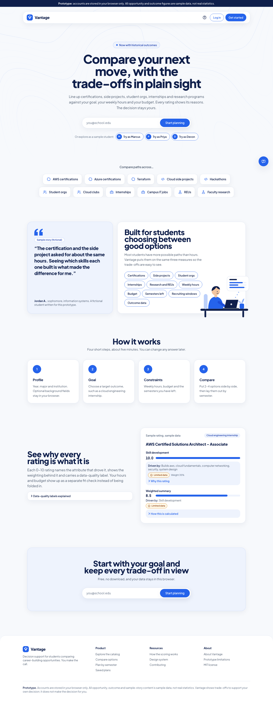
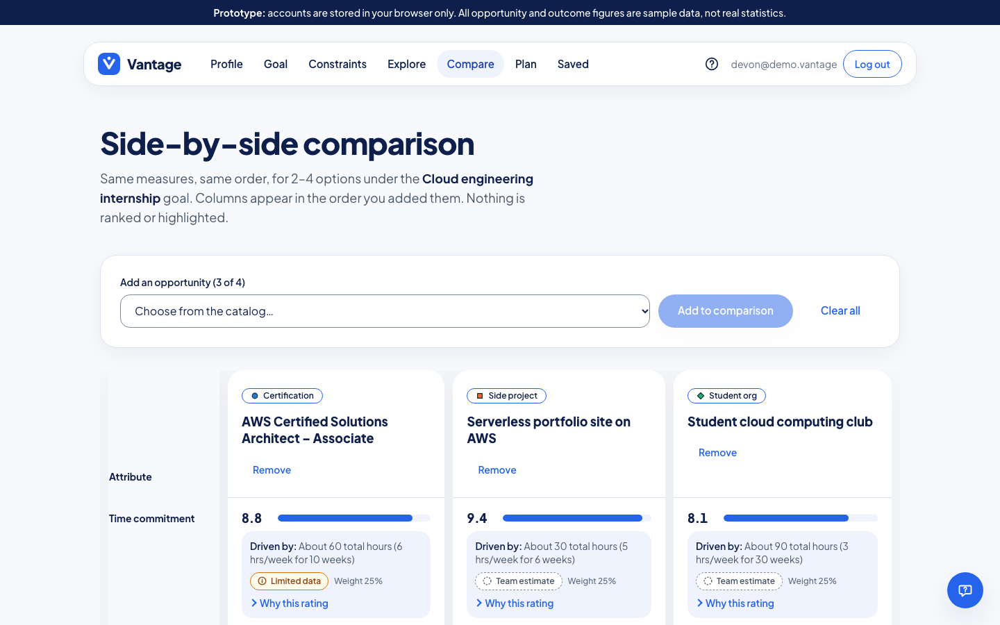
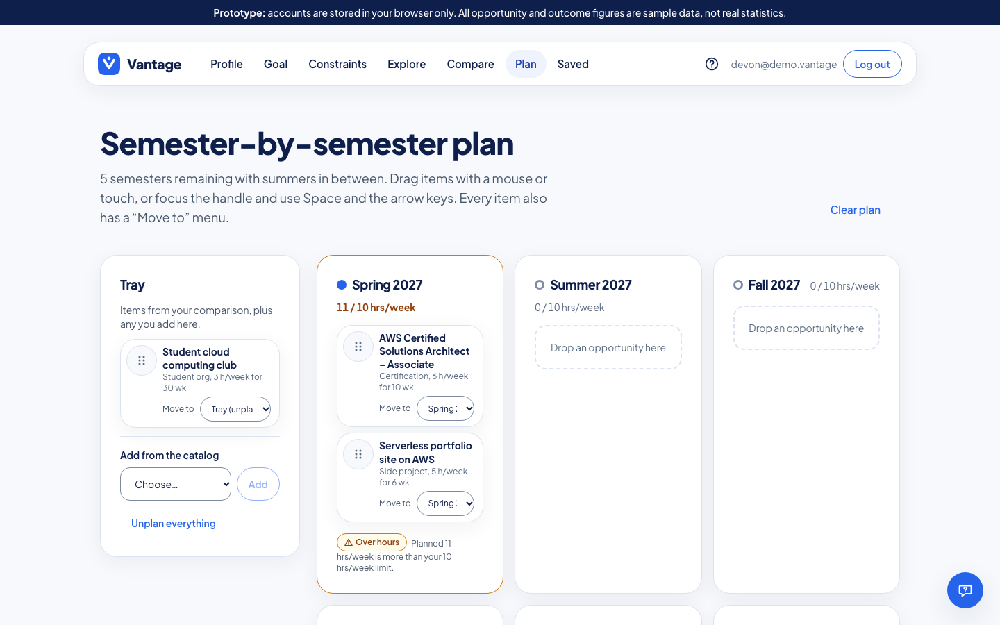
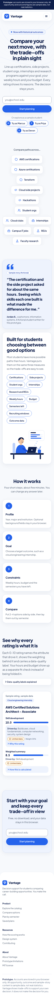
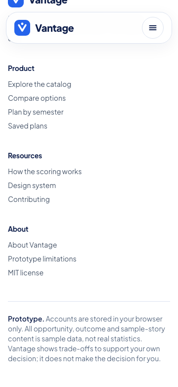

# Vantage

[](https://github.com/Oseipokuamoafo/vantage/actions/workflows/ci.yml)
[](https://github.com/Oseipokuamoafo/vantage/actions/workflows/deploy.yml)
[](LICENSE)

**Decision support for students comparing career-building opportunities.**

Vantage puts certifications, side projects, student orgs, internships and research programs (REUs) side by side.
Each option is measured against a student's goal and their own constraints: weekly hours, budget and semesters left.
Every rating shows what drove it and how reliable the underlying data is. Vantage describes trade-offs and leaves
the decision to the student.

> **Prototype.** Accounts are stored in your browser only. All opportunity and outcome data is sample data, not
> real statistics. See [Prototype limitations](#prototype-limitations).

**Live demo:** https://oseipokuamoafo.github.io/vantage/ · **Repository:** https://github.com/Oseipokuamoafo/vantage

| Landing                                                      | Compare                                                         | Plan                                                      |
| ------------------------------------------------------------ | --------------------------------------------------------------- | --------------------------------------------------------- |
|      |      |  |
|  |  |  |

_Screenshots use the fictional demo personas and sample data. Earlier designs are kept as
`docs/screenshots/before-*.png` for comparison. The design system is documented in
[docs/DESIGN.md](docs/DESIGN.md)._

## Quick start

Requires Node.js 20 or newer.

```bash
git clone https://github.com/Oseipokuamoafo/vantage.git
cd vantage
npm install && npm run dev
```

Open http://localhost:5173 and click **Try as Marcus** (or Priya, or Devon). No backend and no environment
variables are needed.

## Scripts

| Script              | What it does                                                                                                                                                                    |
| ------------------- | ------------------------------------------------------------------------------------------------------------------------------------------------------------------------------- |
| `npm run dev`       | Vite dev server                                                                                                                                                                 |
| `npm run build`     | Forbidden-phrase check → typecheck → production build in `dist/`                                                                                                                |
| `npm run preview`   | Serve the production build                                                                                                                                                      |
| `npm test`          | Vitest unit and component tests                                                                                                                                                 |
| `npm run test:e2e`  | Playwright smoke, keyboard and axe accessibility (WCAG 2.1 AA) tests against a build served under `/vantage/` (desktop and 360px). First run: `npx playwright install chromium` |
| `npm run lint`      | ESLint (including jsx-a11y) and the Prettier check                                                                                                                              |
| `npm run typecheck` | `tsc --noEmit` (strict)                                                                                                                                                         |
| `npm run format`    | Apply Prettier                                                                                                                                                                  |

## Features

| #   | Feature                                                                                           | Requirements |
| --- | ------------------------------------------------------------------------------------------------- | ------------ |
| F1  | Student profile and onboarding (local accounts, login, logout, prototype password reset)          | R1           |
| F2  | Goal definition (goal types come from data)                                                       | R2           |
| F3  | Constraints: weekly hours, budget, semesters remaining                                            | R3, R8       |
| F4  | Opportunity catalog with search and type filters                                                  | R4, R12      |
| F5  | Pure scoring engine: time, skill and signaling, with separate constraint fit                      | R3, R5       |
| F6  | Side-by-side comparison of 2–4 options (swipeable on mobile, never ranked)                        | R5, R6, R9   |
| F7  | Historical outcomes with a minimum sample size and a "No data yet" state                          | R7, R12      |
| F8  | Semester planner with drag-and-drop (mouse, touch, keyboard) and timing/overload flags            | R8           |
| F9  | Transparency panel: rating drivers, data-quality labels, forbidden-phrase guard                   | R9           |
| F10 | Saved plans: save, rename, reopen, delete, and see what changed since saving                      | R10          |
| F11 | Responsive, accessible UI with code-split routes and an onboarding stepper                        | R11          |
| F12 | Admin content manager: opportunities, goal types and weightings, CSV outcome import, edit history | R12          |

The full matrix is in [docs/TRACEABILITY.md](docs/TRACEABILITY.md). The data model and scoring formula are in
[docs/ARCHITECTURE.md](docs/ARCHITECTURE.md). Tokens, components and usage rules are in [docs/DESIGN.md](docs/DESIGN.md).

## Demo personas

Each persona is one click on the landing page ("Try as Marcus", "Try as Priya", "Try as Devon"). It signs you in and prefills profile, goal and constraints.

| Persona    | Shape of need                                                                           | Constraints                    |
| ---------- | --------------------------------------------------------------------------------------- | ------------------------------ |
| **Marcus** | First-generation sophomore at a state school, aiming for a cloud engineering internship | 8 hrs/week, $100, 5 semesters  |
| **Priya**  | Junior with a tight timeline who needs to sequence across her remaining semesters       | 12 hrs/week, $300, 3 semesters |
| **Devon**  | Comparing a certification, a side project and a student org, and how outcomes differ    | 10 hrs/week, $200, 5 semesters |

Persona accounts use the password `demo-persona`.

## Demo admin

| Email                | Password        |
| -------------------- | --------------- |
| `admin@vantage.demo` | `vantage-admin` |

The admin account is created in each browser on first load. **Admin** appears in the navigation after you log in
with it.

## Project structure

```
src/
  App.tsx                 HashRouter + lazy routes
  components/ui/          design system (Button, Card, fields, Badge, ScoreMeter, …)
  components/layout/      AppShell, PrototypeBanner, auth guards
  data/                   localStorage repositories, types, seed/*.json
  features/<feature>/     one folder per feature (see CONTRIBUTING.md for ownership)
  hooks/                  shared hooks
e2e/                      Playwright tests
docs/                     ARCHITECTURE.md, TRACEABILITY.md
.github/                  CI, Pages deploy, issue and PR templates
```

## Deploy to GitHub Pages

1. Push to `main` on GitHub (this repository: `https://github.com/Oseipokuamoafo/vantage.git`).
2. On GitHub, open **Settings → Pages**.
3. Under **Build and deployment**, set **Source** to **GitHub Actions**.
4. The **Deploy to GitHub Pages** workflow runs on every push to `main`. You can also start it from the
   **Actions** tab ("Run workflow").
5. The site is published at https://oseipokuamoafo.github.io/vantage/ (for a fork: `https://<you>.github.io/<repo-name>/`).

The workflow sets `VITE_BASE=/<repo-name>/` automatically, so no configuration is needed, and HashRouter means
GitHub Pages needs no server rewrites. To build for another sub-path locally, run `VITE_BASE=/my-path/ npm run build`.

## Prototype limitations

- **Local-only accounts.** Email and password hashes (salted SHA-256) live in this browser's localStorage. There is
  no server, no email verification, and the password reset has no verification step. Clearing site data deletes
  accounts and plans. Do not reuse a real password.
- **Sample data.** All 22 opportunities, the goal weightings and the signaling ratings are team estimates or limited
  provider data, labelled as such. Costs and durations are plausible but unverified.
- **No real outcome statistics.** Outcome records are fabricated for demonstration. Each one is labelled
  "Prototype sample data: not real statistics".
- **Content edits are per-browser.** Admin changes are stored locally. To share them, commit them to the seed JSON
  files.
- **One complete track.** Only the cloud engineering internship track has full content. Banking and CS PhD tracks
  are placeholders, selectable only in demo mode (Admin → Settings).

## License

[MIT](LICENSE)
